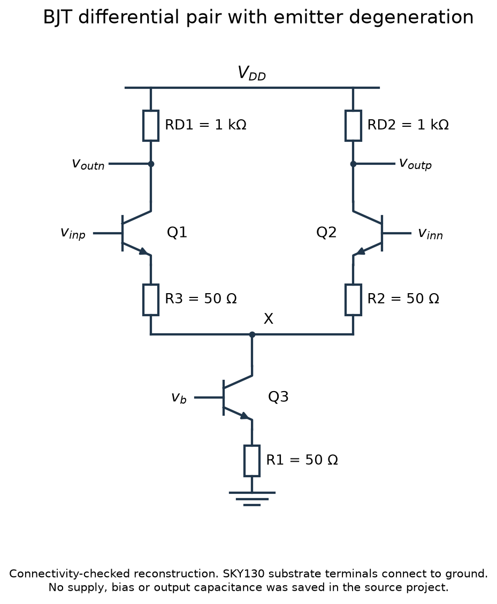
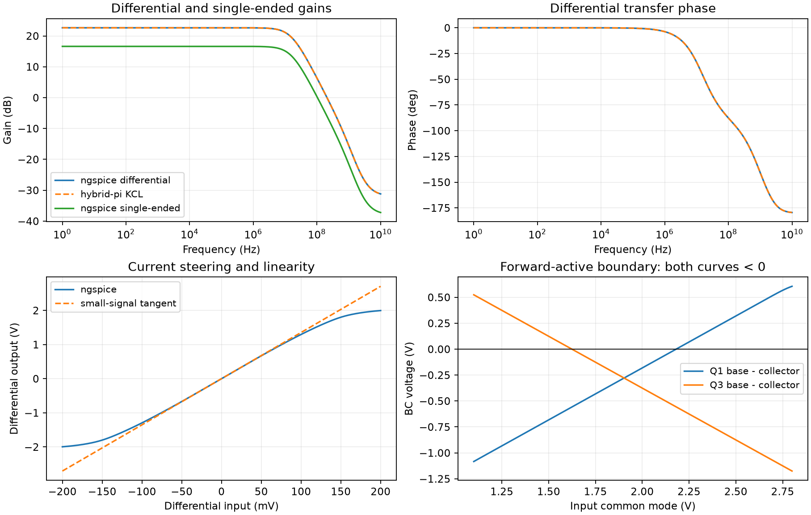
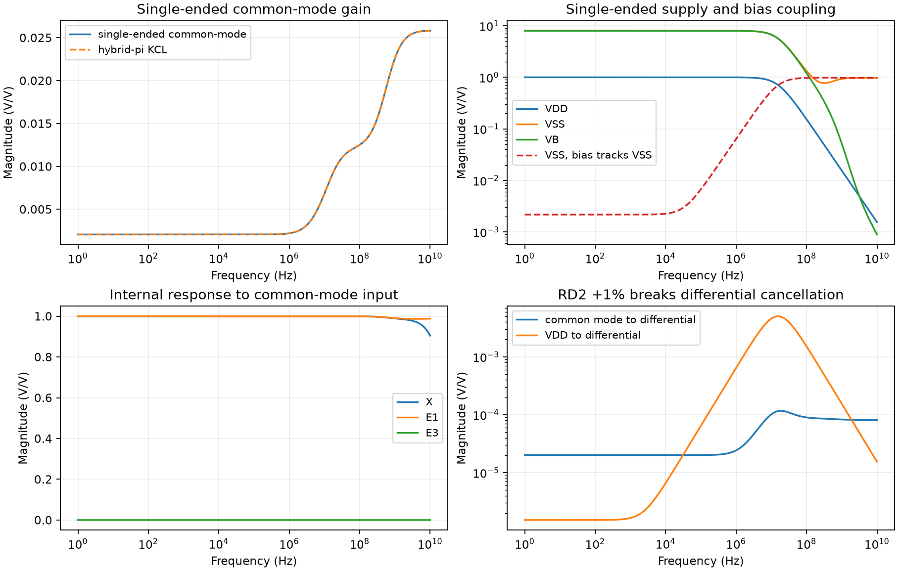
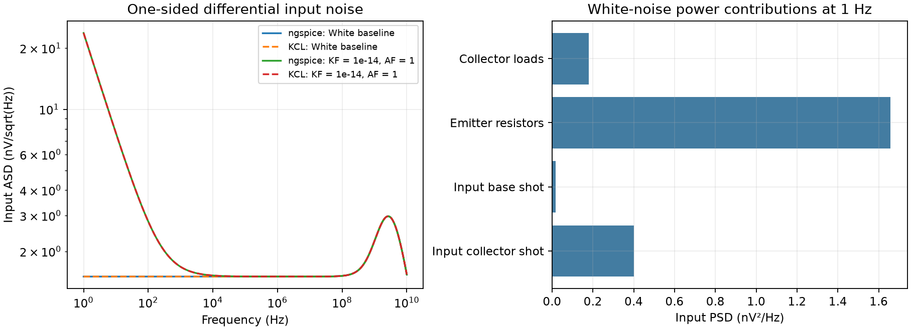
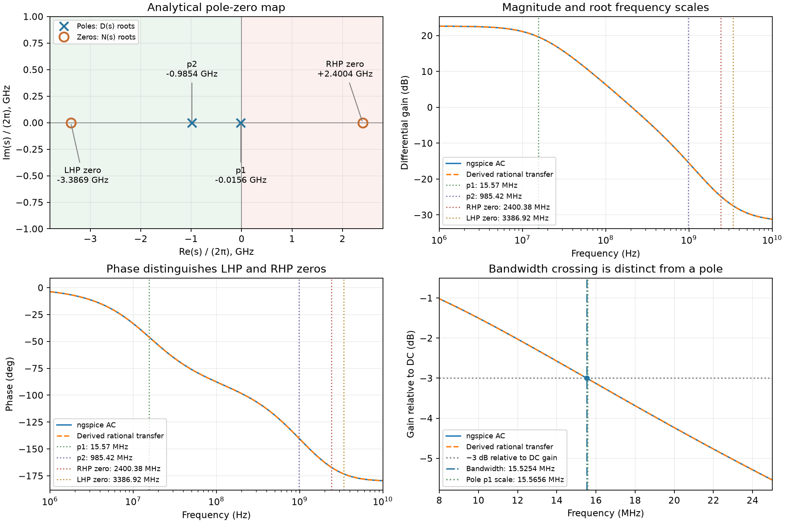
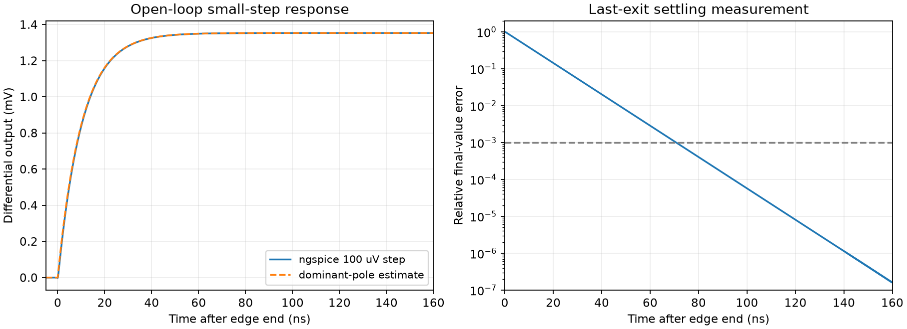

<!-- Input: supplied BJT differential-pair project and 16 ngspice testbenches. Output: schematic, model-specific derivations, simulation plots and numerical comparisons. -->
# BJT Emitter-Degenerated Differential Pair: Schematic and Simulation

This companion document connects the equations in [the analytical reference](BJT-Degenerated-Differential-Pair-Analysis.md) to the supplied schematic, explicit teaching models, executable testbenches, simulation curves, and numerical comparisons. Each metric retains the relevant derivation beside the experiment that checks it. The analytical reference contains the general formulas and their assumptions; this document records the particular model and executed evidence.

**Verification status:** 16 ngspice testbenches were executed on 2026-10-11 and all declared independent checks passed. The original project declares a SKY130 NPN but supplies no model files, bias sources, simulation setups, or output capacitors. The numerical example uses a separately identified educational Gummel–Poon NPN model, added bias and equal output capacitances. These results establish consistency of that model and the circuit equations, not SKY130 process performance. Original project contents are preserved.

## Circuit and Downloadable Files

| File | Purpose and execution status |
|---|---|
| [Analytical reference](BJT-Degenerated-Differential-Pair-Analysis.md) | General topology, definitions, mechanisms, derivations and applicability limits |
| [Original editable project](circuits/bjt-degenerated-differential-pair/CML%20buffer.icproj.json) | Supplied source; original SKY130 bindings and resistor values retained |
| [Structural netlist](simulations/bjt-degenerated-differential-pair/source-structural.cir) | Four-terminal SKY130 calls; requires its external model and a testbench; not executed here |
| [Educational core](simulations/bjt-degenerated-differential-pair/core.cir) and [models](simulations/bjt-degenerated-differential-pair/models.lib) | Teaching reconstruction and model; executed by the testbenches below |
| [Testbenches](simulations/bjt-degenerated-differential-pair/testbenches/) | Bias, AC, DC, supply, mismatch, noise and transient experiments |
| [Raw data and logs](simulations/bjt-degenerated-differential-pair/results/) and [check manifest](simulations/bjt-degenerated-differential-pair/results/checks.json) | Simulator outputs, metrics, validation, execution time and hashes |
| [Extraction script](code/bjt_differential_pair_source.py) and [provenance](circuits/bjt-degenerated-differential-pair/provenance.json) | Connectivity/value assertions and source SHA-256 |
| [Runner](code/run_bjt_differential_pair.py) and [run instructions](simulations/bjt-degenerated-differential-pair/README.md) | Reproduce the numerical checks and PNG/SVG plot pairs |

## 1. Circuit Topology and Definitions



The actual circuit has two resistive collector loads and two output terminals. It is a **differential voltage amplifier with a transconductance input stage**, also usable as a CML buffer. Its 1 kΩ resistors provide current-to-voltage conversion; there is no current-mirror active load or differential-to-single-ended mirror conversion.

| Source component/node | Connection or role | Saved value |
|---|---|---|
| Q1 | Collector = `voutn`, base = `vinp`, emitter = E1 | NPN, multiplier 1 |
| Q2 | Collector = `voutp`, base = `vinn`, emitter = E2 | NPN, multiplier 1 |
| Q3 | Collector = X, base = `vb`, emitter = E3 | NPN tail sink, multiplier 1 |
| RD1, RD2 | VDD to the respective collector | 1 kΩ each |
| R3, R2 | E1/E2 to X | 50 Ω each |
| R1 | E3 to ground | 50 Ω |
| Substrate S | Grounded through saved unrouted electrical connections | External SKY130 terminal |

[The extraction script](code/bjt_differential_pair_source.py) joins saved route endpoints, junctions, contacts, and unrouted electrical connections. It asserts the terminal map and resistor values above before producing [the structural SKY130 netlist](simulations/bjt-degenerated-differential-pair/source-structural.cir) and [provenance](circuits/bjt-degenerated-differential-pair/provenance.json). The figure is a reconstruction of that verified topology, not an image exported by the editor.

Define input and output quantities before assigning gain signs:

$$
v_d=v_{inp}-v_{inn},\qquad v_{cm}=\frac{v_{inp}+v_{inn}}{2},
$$
$$
v_{od}=v_{outp}-v_{outn},\qquad v_{oc}=\frac{v_{outp}+v_{outn}}{2}.
$$

For differential excitation, $v_{inp}=+v_d/2$ and $v_{inn}=-v_d/2$. Increasing `vinp` raises Q1 current and lowers `voutn`; it lowers Q2 current and raises `voutp`. Consequently, $v_{od}/v_d$ and $v_{outp}/v_d$ are **positive**, while $v_{outn}/v_d$ is negative.

| Symbol | Definition | Unit/assumption |
|---|---|---|
| $R_D$ | Each collector resistor | Ω; matched baseline |
| $R_E$ | Each input-pair emitter resistor, R2/R3 | Ω |
| $R_T$ | Tail emitter resistor, R1 | Ω |
| $I_T$ | Q3 collector current = sum of Q1/Q2 emitter currents | A |
| $I_C,I_B$ | Each input transistor's quiescent collector/base current | A |
| $\alpha,\beta$ | $I_C/I_E$, $I_C/I_B$ | $\alpha=\beta/(\beta+1)$ in the simple forward model |
| $V_T$ | Thermal voltage, $kT/q$ | V; 25.865 mV at 27 °C |
| $g_m,g_\pi,g_o$ | Transconductance, base-emitter conductance, output conductance | S; $g_\pi=1/r_\pi$, $g_o=1/r_o$ |
| $r_t$ | Resistance seen into Q3 collector with bias/supply AC grounded | Ω; includes R1 degeneration |
| $C_\pi,C_\mu$ | Linearized base-emitter/base-collector capacitance | F |
| $C_L$ | Added capacitor from each output to the lower rail | F; absent from original project |
| $s,\omega,f$ | Complex frequency, angular frequency, frequency | $s=j\omega$, $\omega=2\pi f$ |

The simple formulas assume matched devices, forward-active operation, low-impedance input/bias voltage sources, and equal loads. Finite $r_\pi$ and $r_o$ are retained where needed. BJT base current and shot noise must not be replaced by MOS gate-current or channel-noise assumptions.

## 2. DC Bias, Headroom, and the Teaching Baseline

### 2.1 Bias equations

At zero differential input, symmetry gives

$$
I_{E1}=I_{E2}=\frac{I_T}{2},\qquad I_C\simeq\alpha\frac{I_T}{2},
$$
$$
V_{E3}=I_{E3}R_T,\qquad V_b=V_{BE3}+I_{E3}R_T,
$$
$$
V_{E1}=V_{E2}=V_{CM}-V_{BE},\qquad
V_X=V_{CM}-V_{BE}-\frac{I_TR_E}{2},
$$
$$
V_{OC}=V_{DD}-I_CR_D.
$$

Q3 collector current is not its emitter current: $I_{E3}=I_T+I_{B3}$. Thus $(V_b-0.7\ \mathrm V)/R_T$ is only a rough estimate, not a bias solution. $V_{BE}$ depends exponentially on current, and Early effect makes $I_T$ depend weakly on $V_X$.

For the simple forward BJT model,

$$
g_m\simeq\frac{I_C}{V_T},\quad r_\pi\simeq\frac{\beta}{g_m},\quad r_o\simeq\frac{V_A}{I_C}.
$$

The simulator's differential parameters are used in the independent numerical equations below. These approximations explain their scale without claiming exact Gummel–Poon identities.

### 2.2 Forward-active constraints

Require conducting BE junctions and reverse-biased BC junctions. A strict baseline criterion is

$$
V_X>V_b,\qquad V_{outn}>V_{inp},\qquad V_{outp}>V_{inn}.
$$

At balanced input, this suggests the implicit common-mode bounds

$$
\boxed{V_b+V_{BE}+\frac{I_TR_E}{2}<V_{CM}<V_{DD}-I_CR_D.}
$$

Currents and junction voltages vary with common mode, so solve the bias and check the inequalities across a sweep. These bounds use $V_{BC}<0$, rather than treating the approximate 0.2 V saturated $V_{CE}$ as sufficient for an active-region small-signal model. Unequal inputs require checking each collector separately.

### 2.3 Declared educational example and executed OP

[Model v1.0.0](simulations/bjt-degenerated-differential-pair/models.lib): IS = $10^{-15}$ A, BF = 100, VAF = 100 V, TF = 200 ps, CJE = 1 pF, CJC = 0.3 pF, and intrinsic RB/RC/RE = 0. Finite beta, Early effect, diffusion charge, junction capacitance, and shot noise are included. The white-noise baseline uses KF = 0; a separate experiment adds KF = $10^{-14}$, AF = 1. These are illustrative parameters, not fitted process data.

**Added conditions:** VDD = 3.3 V, lower rail = 0 V, $V_{CM}=1.8$ V, $V_b=0.85$ V, 27 °C, and $C_L=10$ pF on **each** output. All five saved resistors retain their original values.

| Quantity | Executed ngspice OP |
|---|---:|
| Q1/Q2 $I_C$ | 1.118415 mA each |
| Q1/Q2 $I_B$ | 11.22186 µA each |
| Q3 $I_C=I_T$ | 2.259273 mA |
| Q3 $I_B$ | 22.71997 µA |
| $V_{outn}=V_{outp}$ | 2.181585 V |
| $V_{E1}=V_{E2}$ | 1.082344 V |
| $V_X$ | 1.025862 V |
| $V_{E3}$ | 0.114100 V |
| Q1/Q2 $g_m$, $r_\pi$, $r_o$ | 43.21816 mS, 2.30487 kΩ, 89.1118 kΩ |
| Q1/Q2 $V_{BC}$ | −0.381585 V |
| Q3 $V_{BC}$ | −0.175862 V |

The script verifies $I_{C3}=I_{C1}+I_{B1}+I_{C2}+I_{B2}$ and all three negative $V_{BC}$ values. A 5 mV common-mode sweep finds strict forward-active samples from **1.625 to 2.180 V** at these particular bias settings; these are sampled bounds, not universal input specifications. The boundary curves appear beside the gain experiment below.

VDD supplies about 2.23683 mA or 7.3815 mW through the collector loads. Ideal input and bias sources also supply base current; including their DC source powers gives approximately 7.4412 mW. An actual bias generator and input driver add their own consumption.

### 2.4 Independent full-circuit linearization

The unknown-voltage ordering in the runner is $[v_{outn},v_{outp},v_{E1},v_{E2},v_X,v_{E3}]$. Prescribed base and rail voltages are ordered $[v_{inp},v_{inn},v_b,v_{dd},v_{ss}]$. Each transistor contributes the terminal currents below, with current positive into the transistor and $C_x$ equal to its OP cross-charge derivative:

$$
i_c=g_o(v_c-v_e)+g_m(v_b-v_e)+(g_\mu+sC_\mu)(v_c-v_b),
$$
$$
i_b=(g_\pi+sC_\pi)(v_b-v_e)+(g_\mu+sC_\mu)(v_b-v_c)+sC_x(v_b-v_c),
\qquad i_e=-i_c-i_b.
$$

Here $v_b$ in a device equation means that transistor's base voltage; the externally named tail-bias node is prescribed separately. Each explicit resistor contributes $(v_a-v_b)/R$ to its two-node KCL, and each load capacitor contributes $sC_L(v_{out}-v_{ss})$. Partitioning the independently assembled admittance matrix into unknown and prescribed voltages gives

$$
Y_{uu}v_u=-Y_{uk}v_k+i_{test}.
$$

The AC calculations solve this system at every exported frequency. Noise calculations use the same matrix with a source-specific injection vector and sum output powers. OP parameters come from ngspice, but the nodal assembly, solution and reduced formulas are constructed independently. This full model includes reverse-junction conductance; the simpler closed forms below state where it is neglected.

## 3. Differential Gain and Current Steering

### 3.1 Mechanism and first approximation

Matched differential excitation makes $v_X=0$ by symmetry. This is a **virtual ground for this excitation**, not a physical short and not the common-mode behavior. Each input transistor sees $R_E$ to this virtual ground.

Ignoring Early effect initially, emitter KCL gives

$$
\frac{v_e}{R_E}=(g_m+g_\pi)(v_b-v_e),
$$
$$
v_\pi=\frac{v_b}{1+(g_m+g_\pi)R_E},\qquad
G_d=\frac{i_c}{v_b}=\frac{g_m}{1+(g_m+g_\pi)R_E}.
$$

Therefore,

$$
\boxed{A_{dd}\equiv\frac{v_{od}}{v_d}\simeq G_dR_D,\qquad
A_{sd}\equiv\frac{v_{outp}}{v_d}\simeq\frac{G_dR_D}{2}.}
$$

The factor of two matters: with resistor loads there is no mirror that combines both branch signal currents into one output. With $g_mR_E\gg1$, $G_d\simeq\alpha/R_E$ and $A_{dd}\simeq\alpha R_D/R_E$. Raising bias then yields diminishing gain improvement.

### 3.2 Closed form with finite beta and Early effect

Let $G_D=1/R_D$ and $G_E=1/R_E$. At DC, the half-circuit equations are

$$
\begin{bmatrix}
G_D+g_o&-(g_m+g_o)\\
-g_o&G_E+g_m+g_\pi+g_o
\end{bmatrix}
\begin{bmatrix}v_c\\v_e\end{bmatrix}
=\begin{bmatrix}-g_m\\g_m+g_\pi\end{bmatrix}v_b.
$$

For any effective emitter-to-ground conductance $G$, define

$$
F=\frac{G_D}{G_D+g_o},\qquad
D(G)=G+g_\pi+F(g_m+g_o),
$$
$$
H(G)=\frac{v_c}{v_b}=
\frac{g_og_\pi-g_mG}{(G_D+g_o)D(G)}.
$$

The matched differential gains are

$$
\boxed{A_{dd}=-H(G_E),\qquad A_{sd}=-\frac{H(G_E)}{2}.}
$$

This is exact within the stated DC hybrid-pi model, neglecting reverse-junction $g_\mu$ (about $10^{-12}$ S here). It is not the simpler $g_m(r_o\parallel R_D)$ of an undegraded common-emitter stage.

### 3.3 Derivation → testbench → comparison

The AC deck uses a unit differential source through +0.5/−0.5 voltage-controlled sources, with common mode and both supplies AC grounded. It sweeps 1 Hz–10 GHz. A DC differential sweep uses −200 to +200 mV in 0.5 mV steps at fixed 1.8 V common mode; its central derivative is a separate check.



| Quantity | Independent equation | ngspice | Difference |
|---|---:|---:|---:|
| $A_{dd}(0)$, simple $G_dR_D$ | 13.57951 V/V | 13.52831 V/V | Approximation is 0.378% high |
| $A_{dd}(0)$, finite-$r_o$ closed form | 13.52831137 V/V | 13.52831140 V/V | Below $10^{-6}$ relative |
| $A_{sd}(0)$ at `voutp` | 6.764156 V/V | 6.764156 V/V | Positive polarity confirmed |
| Central DC derivative | AC prediction 13.528311 V/V | 13.528298 V/V | −0.000096% |

The full complex nodal prediction overlays the AC sweep, including phase. Numerical agreement verifies wiring, normalization, and small-signal equations for this teaching model; its device parameters come from ngspice OP, so bias extraction itself is not independent.

**Raw evidence:** [differential AC deck](simulations/bjt-degenerated-differential-pair/testbenches/ac-dm.cir), [AC data](simulations/bjt-degenerated-differential-pair/results/ac-dm.dat), [differential DC deck](simulations/bjt-degenerated-differential-pair/testbenches/dc-transfer.cir), and [DC data](simulations/bjt-degenerated-differential-pair/results/dc-transfer.dat).

### 3.4 Large-signal linearity

With a fixed tail current, negligible Early effect, and constant $\alpha$, define $\delta=(I_{C1}-I_{C2})/(I_{C1}+I_{C2})$. The two BE exponentials and resistor drops give

$$
\boxed{v_d=2V_T\operatorname{atanh}(\delta)+R_EI_T\delta,\qquad
v_{od}=\alpha I_TR_D\delta.}
$$

Without degeneration, $\delta=\tanh(v_d/(2V_T))$. Degeneration adds the linear term $R_EI_T\delta$, increasing the useful input range. Differentiating at $\delta=0$ recovers $G_dR_D$ with $g_m=\alpha I_T/(2V_T)$.

This steering relation assumes both input devices and Q3 remain active; the actual DC sweep includes changing tail current and eventual headroom limits. Its slope near zero agrees with AC, while large inputs depart from the tangent.

## 4. Tail Resistance, Internal Nodes, Common-Mode Gain, and CMRR

### 4.1 Tail output resistance with finite beta

With Q3 base and lower rail AC grounded, let $G_T=1/R_T$ and use Q3 parameters with subscript 3. Its emitter voltage obeys

$$
v_{e3}=\frac{g_{o3}}{G_T+g_{m3}+g_{\pi3}+g_{o3}}v_X.
$$

Substituting into $i_{c3}=g_{o3}v_X-(g_{m3}+g_{o3})v_{e3}$ yields

$$
\boxed{r_t=\frac{G_T+g_{m3}+g_{\pi3}+g_{o3}}{g_{o3}(G_T+g_{\pi3})}
=r_{o3}+(1+g_{m3}r_{o3})(R_T\parallel r_{\pi3}).}
$$

Finite beta limits the resistance boost because the base is fixed by an ideal bias source. In the example, $r_t=228.108$ kΩ. This is an analytical extraction from OP parameters; the executed output-injection deck measures the **amplifier's loaded output resistance**, not an isolated measurement of $r_t$.

### 4.2 Common-mode mechanism and exact DC solution

Both emitters now move together. Tail KCL gives

$$
2\frac{v_e-v_X}{R_E}=\frac{v_X}{r_t},\qquad
v_X=\frac{2r_t}{R_E+2r_t}v_e.
$$

Each half-circuit therefore sees the common-mode emitter impedance $R_E+2r_t$, rather than $R_E$. Set $G_C=1/(R_E+2r_t)$ in the preceding closed form:

$$
\boxed{A_{sc}\equiv\frac{v_{outp}}{v_{cm}}=H(G_C),\qquad
\frac{v_e}{v_{cm}}=\frac{g_\pi+Fg_m}{D(G_C)}.}
$$
$$
\frac{v_X}{v_{cm}}=\frac{2r_t}{R_E+2r_t}\frac{g_\pi+Fg_m}{D(G_C)}.
$$

Neglecting $g_o$ in the input pair gives the useful approximation

$$
A_{sc}\simeq-\frac{g_mR_D}{1+(g_m+g_\pi)(R_E+2r_t)}
\simeq-\frac{\alpha R_D}{2r_t}
$$

for a large tail impedance. The exact numerator contains $g_og_\pi$: a product small in absolute terms can matter for a very small common-mode gain. Even $r_t\to\infty$ does not force single-ended common-mode gain to zero when finite beta and Early effect are both retained.

In this circuit the high tail resistance allows X to **track common-mode input almost one-for-one**. A high-impedance tail is not an AC-ground condition for common-mode excitation.

### 4.3 Define the CMRR being quoted

Single-ended CMRR, using the same output for both gains, is

$$
\boxed{\mathrm{CMRR}_{se}=\left|\frac{A_{sd}}{A_{sc}}\right|,
\qquad \mathrm{CMRR}_{se,dB}=20\log_{10}\mathrm{CMRR}_{se}.}
$$

The first-order approximation is

$$
\mathrm{CMRR}_{se}\simeq
\frac{1+(g_m+g_\pi)(R_E+2r_t)}{2[1+(g_m+g_\pi)R_E]}.
$$

It approaches $g_mr_t$ without input degeneration, and approximately $r_t/R_E$ with strong input degeneration. Increasing tail resistance improves rejection, while input degeneration reduces differential gain.

For the **differential output**, ideal matched common-mode excitation produces $v_{outp}=v_{outn}$ and hence $A_{dc}=v_{od}/v_{cm}=0$. Its ideal CMRR is unbounded. That symmetry result is not a finite production specification; device/load mismatch, unequal source impedances, and asymmetric parasitics establish practical rejection.

### 4.4 Test and comparison

The common-mode AC deck excites both bases by 1 V in the linearized model, with bias and rails grounded. This is a transfer normalization, not a 1 V large-signal experiment. The mismatch experiment changes **only RD2 to 1.01 kΩ**, solves its changed DC OP, and uses those OP parameters for an independent AC prediction.



| Quantity | Independent prediction | ngspice |
|---|---:|---:|
| $A_{sc}$, approximate | −0.00216981 V/V | −0.00205752 V/V; magnitude approximation is 5.46% high |
| $A_{sc}$, finite-$r_o$ closed form | −0.00205752087 V/V | −0.00205752036 V/V |
| $v_X/v_{cm}$ | 0.999583 | 0.999583 |
| $v_{E1}/v_{cm}$ | 0.999692 | 0.999692 |
| $v_{E3}/v_{cm}$ | 0.000209885 | 0.000209885 |
| Single-ended CMRR | 70.3374 dB | 70.3374 dB |
| RD2 +1%: $v_{od}/v_{cm}$ | −$2.00658\times10^{-5}$ V/V | −$2.00658\times10^{-5}$ V/V |

All matched common-mode differential-output samples are zero in the exported data. No finite dB number is assigned to numerical zero. The mismatch experiment is deterministic, not Monte Carlo yield analysis.

**Raw evidence:** [common-mode deck](simulations/bjt-degenerated-differential-pair/testbenches/ac-cm.cir), [common-mode data](simulations/bjt-degenerated-differential-pair/results/ac-cm.dat), [mismatch deck](simulations/bjt-degenerated-differential-pair/testbenches/mismatch-cm.cir), and [mismatch data](simulations/bjt-degenerated-differential-pair/results/mismatch-cm.dat).

## 5. Input and Output Impedance

### 5.1 Differential input resistance

With negligible Early effect, each base sees

$$
R_{in,half}=r_\pi+(\beta+1)R_E,
\qquad
\boxed{R_{in,d}=2[r_\pi+(\beta+1)R_E].}
$$

Define the differential input-port current as $i_d=(i_{bp}-i_{bn})/2$. The AC test obtains base currents from the branch currents of the controlled voltage sources and measures $Z_{in,d}=v_d/i_d$. The full model gives **14.5549 kΩ** at 1 Hz. With finite beta, the DC driver must also supply approximately 11.22 µA per input in this example.

Common-mode input impedance is different because the shared tail moves. In the same simple model, each input sees approximately $r_\pi+(\beta+1)(R_E+2r_t)$ under equal common-mode drive. Capacitive input impedance and a finite source resistance require the full frequency-dependent equations.

### 5.2 Output resistance and port conventions

With a transistor base AC grounded and an emitter resistance $R$, its collector resistance is

$$
r_{c,deg}=r_o+(1+g_mr_o)(R\parallel r_\pi).
$$

For a pure differential output test, use $R=R_E$:

$$
R_{out,half,d}=R_D\parallel r_{c,deg},\qquad
R_{out,d}=2R_{out,half,d}.
$$

For common output motion, replace $R_E$ by $R_E+2r_t$. Injecting a current into **only one output** while leaving the other free excites both modes, so

$$
R_{out,se}=\frac{R_{out,half,d}+R_{out,half,c}}{2}
$$

in the matched DC model. The executed deck injects 1 A AC into `voutp` with both inputs and bias grounded and measures **998.150 Ω**. Its full complex nodal prediction is checked over the frequency sweep. The one-ampere source is a small-signal normalization.

The load resistors keep the output resistance near 1 kΩ; quoting the intrinsic BJT $r_o$ as the amplifier output resistance would substantially overestimate gain and the output time constant.

**Raw evidence:** [one-output current-injection deck](simulations/bjt-degenerated-differential-pair/testbenches/output-resistance.cir) and [impedance-test data](simulations/bjt-degenerated-differential-pair/results/output-resistance.dat). The differential input currents are retained in the differential AC data linked above.

## 6. Power-Supply Rejection and Bias Sensitivity

### 6.1 Supply references are part of the definition

Introduce a lower-rail perturbation $v_{ss}$ in the teaching deck. It moves the bottom of R1 and the output load capacitors. Input common mode remains referenced to the original global ground. Two separate lower-rail tests distinguish:

- **Fixed bias:** the Q3 base is held at global ground in AC.
- **Tracking bias:** $v_b-v_{ss}$ is held constant, so $v_b=v_{ss}$ in AC.

The original project has ground, not an independently saved VSS pin. This rail split is an added diagnostic experiment. The three-terminal teaching BJT has no substrate parasitics; no substrate PSRR is claimed for the original four-terminal SKY130 device.

For a selected single-ended output,

$$
H_{DD}=\frac{v_{outp}}{v_{dd}},\quad H_{SS}=\frac{v_{outp}}{v_{ss}},\quad
H_B=\frac{v_{outp}}{v_b},\qquad
\mathrm{PSRR}_{se}^{\pm}=\left|\frac{A_{sd}}{H_{DD/SS}}\right|.
$$

### 6.2 Why upper-rail coupling is large

At low frequency and with negligible Early effect, the collector current is almost supply independent and the resistor drop is almost constant. Thus

$$
\boxed{H_{DD}\simeq1.}
$$

The output common mode follows VDD. This follows from a **resistor to VDD**, not from treating a mirror output transistor as diode connected. Matched outputs follow together, so the differential supply transfer is zero in the symmetric model.

### 6.3 Why lower-rail rejection depends on the bias generator

Eliminate Q3 emitter voltage in its low-frequency equations:

$$
i_{c3}=\frac{v_X-v_{ss}}{r_t}+G_{B3}(v_b-v_{ss}),
$$
$$
G_{B3}=\frac{g_{m3}G_T-g_{o3}g_{\pi3}}
{G_T+g_{m3}+g_{\pi3}+g_{o3}}.
$$

If the base does not track the lower rail, the rail changes $V_{BE3}$ and therefore tail current. Approximately,

$$
H_B\simeq-\frac{\alpha R_DG_{B3}}{2},\qquad
H_{SS,\,fixed\ bias}\simeq- H_B.
$$

For tracking bias, linearity gives

$$
\boxed{H_{SS,\,tracking}=H_{SS,\,fixed}+H_B.}
$$

At DC, translating all inputs, bias, and rails together by the same voltage translates the outputs by that voltage. Consequently,

$$
A_{sc}+H_{DD}+H_{SS,\,fixed}+H_B=1,
$$
$$
H_{SS,\,tracking}=1-H_{DD}-A_{sc}\simeq-A_{sc}
$$

when $H_{DD}\simeq1$. The common-mode/negative-PSRR correspondence requires this particular bias-reference choice; it is not automatic.

### 6.4 Test and numerical result

Separate supply and bias AC decks use unit sources and identical frequency grids. The tracking-bias deck references the bias voltage source directly to VSS; its result is also checked against the independent superposition above. The associated curves are in the preceding rejection figure.

| Test | Signed low-frequency transfer | Single-ended rejection |
|---|---:|---:|
| VDD perturbation | $H_{DD}=+0.999887947$ V/V | PSRR+ = 16.6052 dB |
| VSS, global-ground-fixed bias | $H_{SS}=+7.98810502$ V/V | PSRR− = −1.44460 dB |
| Bias voltage perturbation | $H_B=-7.98593545$ V/V | Bias sensitivity, not a supply-PSRR metric |
| VSS, bias tracks VSS | $H_{SS}=+0.00216957358$ V/V | PSRR− = 69.8768 dB |
| RD2 +1%: VDD to differential output | −$1.52454\times10^{-6}$ V/V | Finite mismatch leakage |

Negative PSRR in the fixed-bias test means that supply-to-output coupling exceeds signal-to-output gain under those definitions. The nearly 71 dB change between the two VSS tests comes from the bias reference, not a different transistor or resistor.

Ideal matched differential PSRR is unbounded for these symmetric perturbations. Real bias-generator noise, device mismatch, and asymmetric parasitics must be evaluated separately.

**Raw evidence:** [VDD deck](simulations/bjt-degenerated-differential-pair/testbenches/ac-vdd.cir), [fixed-bias VSS deck](simulations/bjt-degenerated-differential-pair/testbenches/ac-vss.cir), [tracking-bias VSS deck](simulations/bjt-degenerated-differential-pair/testbenches/ac-vss-tracking-bias.cir), and their [exported data](simulations/bjt-degenerated-differential-pair/results/).

## 7. Noise Analysis

### 7.1 Conventions and included mechanisms

All PSDs here are **one-sided**: current PSD in A²/Hz, voltage PSD in V²/Hz, amplitude spectral density (ASD) in V/√Hz, and finite-band integrated noise in V RMS. Input reference is the same differential $v_d$ used for $A_{dd}$. Uncorrelated source powers are summed before taking a square root.

For the educational NPN model [2, 3], the independent source list contains collector shot noise $2q|I_C|$, base shot noise $2q|I_B|$, resistor thermal noise $4kT/R$ as a Norton current PSD, and the optional base-emitter flicker source $\mathrm{KF}|I_B|^{\mathrm{AF}}/f$. Intrinsic RB/RC/RE are zero; only the five explicit resistors generate resistor noise. Ideal external voltage sources contribute none.

The model's collector and base noise sources are independent. It does not establish device noise correlations in a more advanced physical model. Bias-source noise, finite source resistance, mismatch, and sampling aliases are excluded.

### 7.2 Low-frequency derivation with negligible Early effect

Let $a=1+(g_m+g_\pi)R_E$ and $G_d=g_m/a$.

**Input collector shot noise.** For a collector-to-emitter noise source $i_{nc}$, emitter KCL changes $v_e$ and partially cancels the direct collector-current disturbance. The residual collector current is

$$
i_{out,nc}=i_{nc}\frac{1+g_\pi R_E}{a}.
$$

Referred through $G_d$, each device contributes $2qI_C[(1+g_\pi R_E)/g_m]^2$. The two devices give

$$
S_{v,collector}\simeq\frac{4qI_C}{g_m^2}(1+g_\pi R_E)^2.
$$

**Input base shot noise.** With ideal base voltage sources, a base-to-emitter noise source creates an emitter disturbance through $R_E$, leading to the equivalent input voltage $R_Ei_{nb}$ in this approximation:

$$
S_{v,base}\simeq4qI_BR_E^2.
$$

**Emitter resistor thermal noise.** Each series resistor's $4kTR_E$ voltage noise is equivalent to a branch input voltage; the differential sum is

$$
S_{v,R_E}\simeq8kTR_E.
$$

**Collector resistor thermal noise.** The two load-current PSDs produce differential output voltage noise $8kTR_D$, giving

$$
S_{v,R_D}\simeq\frac{8kT}{R_DG_d^2}.
$$

Therefore the engineering white-noise estimate is

$$
\boxed{S_{v,white}\simeq
\frac{4qI_C}{g_m^2}(1+g_\pi R_E)^2
+4qI_BR_E^2+8kTR_E+\frac{8kT}{R_DG_d^2}.}
$$

This replaces the MOS $4kT\gamma g_m$ channel-noise expressions. In the matched circuit, Q3 and R1 noise drive common output motion and cancel at the **differential output**. They do contribute to a single-ended noise measurement; cancellation is lost with mismatch.

Adding physical base resistance or finite driver impedance changes base-noise propagation. The ideal-source expression above must then be extended, rather than omitting the new current-to-voltage conversion.

### 7.3 Flicker noise and finite integration

For ngspice's Gummel–Poon KF/AF convention [3], and the same low-frequency approximation,

$$
S_{v,1/f}\simeq 2R_E^2\frac{\mathrm{KF}|I_B|^{\mathrm{AF}}}{f}.
$$

KF is an empirical model coefficient used with currents in amperes and frequency in hertz; it is not the MOS area/$C_{ox}$ coefficient. With AF = 1, the example's KF = $10^{-14}$ produces an approximately **248.74 Hz** differential input-noise corner. It was selected as a teaching example, not extracted from the declared SKY130 device.

For $S_v=S_0+K_v/f$ over a band where that approximation holds,

$$
v_{n,rms}^2=S_0(f_H-f_L)+K_v\ln\frac{f_H}{f_L},\qquad f_L>0.
$$

The executed result uses the numerical spectral integral over **10 Hz–10 MHz**. Input-referred integration does not include an extra output-pole rolloff: output noise has already been divided by the signal gain. Output RMS would instead integrate $S_{v,out}$.

### 7.4 Test, independent propagation, and comparison

The noise command measures `v(voutp,voutn)` and references the independent differential source VDM. Each noise source is also injected into the independently assembled nodal equations:

$$
S_{v,in}(f)=\frac{\sum_k|h_k(f)|^2S_k(f)}{|A_{dd}(f)|^2}.
$$

The baseline and KF extension both agree over the complete 1 Hz–10 GHz sweep within $8\times10^{-5}$ relative PSD tolerance; the absolute tolerance is $10^{-30}$ V²/Hz. High-frequency agreement is a model-consistency check, not an RF process validation.



| Quantity | Independent propagation | ngspice |
|---|---:|---:|
| Low-frequency white input ASD | 1.50230 nV/√Hz | 1.50230 nV/√Hz |
| Q1/Q2 collector shot PSD | 0.40058 nV²/Hz total | Included in matched total |
| Q1/Q2 base shot PSD | 0.01799 nV²/Hz total | Included in matched total |
| R2/R3 thermal PSD | 1.65849 nV²/Hz total | Included in matched total |
| RD1/RD2 thermal PSD | 0.17985 nV²/Hz total | Included in matched total |
| Q3/R1 differential contribution | Zero by symmetry | Total agrees without a differential tail term |
| White input RMS, 10 Hz–10 MHz | 4.75081 µV | 4.75081 µV |
| White + flicker input RMS, same band | 4.75162 µV | 4.75162 µV |

The emitter resistors dominate the white-noise budget in this example. Their linearity benefit is paid for with reduced gain and added thermal noise. A small integrated flicker penalty over a wide band does not imply negligible low-frequency ASD.

**Raw evidence:** [white-noise deck](simulations/bjt-degenerated-differential-pair/testbenches/noise-white.cir), [white-noise spectrum](simulations/bjt-degenerated-differential-pair/results/noise-white.dat), [flicker-noise deck](simulations/bjt-degenerated-differential-pair/testbenches/noise-flicker.cir), and [flicker-noise spectrum](simulations/bjt-degenerated-differential-pair/results/noise-flicker.dat).

## 8. Poles, Zeros, and Transfer Function

### 8.1 Differential half-circuit, including BJT charge

There is no mirror node, so a mirror pole and its associated zero cannot be imported from the 5T OTA. Under matched differential drive, X is fixed by symmetry; Q3's common-mode dynamics do not enter the differential transfer.

Set $C_o=C_L+C_\mu$ and introduce $C_x=\partial Q_{BE}/\partial V_{BC}$, ngspice's signed `cexbc` cross-charge parameter. Forward diffusion charge also depends on BC voltage through Early effect; here $C_x=-2.24437$ fF. It is a controlled charge derivative, not a standalone negative capacitor. Including it removes a small but detectable high-frequency error in a reciprocal $C_\pi/C_\mu$-only model [4].

With reverse-junction conductance neglected, the exact differential half-circuit equations for this charge model are

$$
\begin{bmatrix}
G_D+g_o+sC_o&-(g_m+g_o)\\
sC_x-g_o&G_E+g_m+g_\pi+g_o+sC_\pi
\end{bmatrix}
\begin{bmatrix}v_c\\v_e\end{bmatrix}
=\begin{bmatrix}sC_\mu-g_m\\g_m+g_\pi+s(C_\pi+C_x)\end{bmatrix}v_b.
$$

Define $B=G_E+g_m+g_\pi+g_o$. Cramer's rule gives

$$
H_d(s)=\frac{v_c}{v_b}=\frac{N(s)}{D(s)},\qquad
\boxed{A_{dd}(s)=-H_d(s),\quad A_{sd}(s)=-\frac{H_d(s)}{2},}
$$
$$
D(s)=C_oC_\pi s^2+
[(G_D+g_o)C_\pi+C_oB+(g_m+g_o)C_x]s
+(G_D+g_o)B-g_o(g_m+g_o),
$$
$$
N(s)=C_\mu C_\pi s^2+
[C_\mu B+g_oC_\pi+(g_m+g_o)C_x]s
+g_og_\pi-g_mG_E.
$$

Setting $s=0$ recovers the DC gain above. Roots of $D$ are poles; roots of $N$ are zeros. Factors for an LHP zero use $1+s/\omega_z$; an RHP zero uses $1-s/\omega_z$. Their signs are determined from these roots rather than a copied template.

### 8.2 Useful bandwidth estimates and computed roots

For a dominant load capacitance,

$$
\omega_{p,o}\simeq\frac{1}{R_{out,half,d}C_o}.
$$

A rough emitter-node scale is $\omega_{p,e}\sim B/C_\pi$. Node coupling shifts both, so the polynomial roots are used for numerical comparisons.

### 8.3 Pole-zero map and transfer-function verification

With two negative real poles, one positive real zero and one negative real zero, the derived transfer can also be written

$$
A_{dd}(s)=A_{dd}(0)
\frac{(1-s/s_{z+})(1+s/|s_{z-}|)}
{(1+s/|s_{p1}|)(1+s/|s_{p2}|)}.
$$

Both zeros increase the asymptotic magnitude slope, but an RHP zero adds phase lag while an LHP zero adds phase lead. A magnitude curve alone cannot identify the zero's half-plane. The map below shows signed complex root locations; the vertical markers on the Bode plots show their positive frequency scales $|s_k|/(2\pi)$, not points on the actual $j\omega$ sweep.

**Testbench:** [differential AC](simulations/bjt-degenerated-differential-pair/testbenches/ac-dm.cir), using the 3.3 V supply, 1.8 V input common mode, 0.85 V bias, 27 °C, and 10 pF per-output loads declared in Section 2. A unit differential excitation through +0.5/−0.5 sources produces $A_{dd}=v(voutp,voutn)/v_d$. The actual 1 Hz–10 GHz complex data are overlaid with $-N(j2\pi f)/D(j2\pi f)$, evaluated from the independently derived polynomial and OP parameters.



The upper-left panel uses analytical polynomial roots. The upper-right and lower-left panels compare ngspice magnitude/phase with the rational transfer and mark both poles and both zeros. The lower-right panel magnifies the −3 dB crossing to distinguish the measured bandwidth from the dominant-pole scale; their near coincidence here follows from output-pole dominance.

| Root/metric | Independent reduced transfer | Simulation comparison |
|---|---:|---|
| Dominant pole $s_{p1}$ | −$9.78014\times10^7$ rad/s, magnitude 15.56558 MHz | Full complex AC overlay checked |
| Other differential pole $s_{p2}$ | −$6.19158\times10^9$ rad/s, magnitude 985.421 MHz | Full complex AC overlay checked |
| RHP zero $s_{z+}$ | +$1.50820\times10^{10}$ rad/s, magnitude 2.40038 GHz | Full rational transfer checked |
| LHP zero $s_{z-}$ | −$2.12806\times10^{10}$ rad/s, magnitude 3.38692 GHz | Full rational transfer checked |
| −3 dB bandwidth | Transfer crossing, rather than pole magnitude | 15.5254 MHz from ngspice AC |

The root values are calculated from the independently derived half-circuit polynomial, not obtained from a separate SPICE `.pz` run. Agreement of the entire complex transfer supplies the verification. A −3 dB crossing uses logarithmic-frequency interpolation relative to the 1 Hz gain.

The maximum relative complex-transfer difference over the full sweep is $7.16\times10^{-9}$. The rational transfer predicts a −3 dB bandwidth of 15.52539725 MHz, while the exported AC data give 15.52539718 MHz. This comparison checks phase as well as magnitude; the root map itself remains an analytical calculation.

**Raw evidence:** [complex AC data](simulations/bjt-degenerated-differential-pair/results/ac-dm.dat), [AC log](simulations/bjt-degenerated-differential-pair/results/ac-dm.log), and [root/bandwidth/error manifest](simulations/bjt-degenerated-differential-pair/results/checks.json). The [runner](code/run_bjt_differential_pair.py) regenerates the root map and all transfer overlays as [PNG](figures/bjt-degenerated-differential-pair/poles-zeros-and-transfer.png) and [SVG](figures/bjt-degenerated-differential-pair/poles-zeros-and-transfer.svg).

Base-collector feedforward accounts for the RHP zero; input emitter dynamics produce the additional order. Finite source impedance adds input states and Miller loading. These GHz roots depend on the illustrative capacitances and ideal drivers and should not be interpreted as SKY130 bandwidth predictions.

## 9. Settling, Slew, and Stability Limits

### 9.1 Small open-loop step

For a dominant-pole response,

$$
\tau\simeq\frac{1}{|s_{p1}|},\qquad
t_\epsilon\simeq\tau\ln\frac{1}{\epsilon}.
$$

The executed differential step is 100 µV, begins at 20 ns, and rises over 50 ps. It stays in the local linear region. The final output change is measured from the last 20 ns of a 250 ns record. Settling is measured from the **end of the input edge** as the first sample following the last exit from the specified error band; error is normalized to the final output change.



| Quantity | Independent prediction | ngspice |
|---|---:|---:|
| Final differential output change | $A_{dd}(0)\times100$ µV = 1.352831 mV | 1.352831 mV |
| 1% settling | Dominant pole: 47.09 ns | 47.286 ns |
| 0.1% settling | Dominant pole: 70.63 ns | 70.836 ns |

The second pole and finite rise time explain the small departure from a single exponential. The observed poles and zeros do not form a nearby slow pole-zero doublet. Settling is determined from actual residues/response; a difference of pole and zero frequencies is not a general settling-time formula.

**Raw evidence:** [small-step deck](simulations/bjt-degenerated-differential-pair/testbenches/transient.cir) and [transient data](simulations/bjt-degenerated-differential-pair/results/transient.dat).

### 9.2 Large steps and feedback

For each output, the actual charge balance is

$$
C_L\frac{dV_{out}}{dt}=\frac{V_{DD}-V_{out}}{R_D}-I_C
$$

when parasitic charge terms can be neglected. Thus this resistor-loaded circuit does not have a universal single-ended slew rate $I_T/C_L$. Immediately after ideal full steering from the balanced state, with fixed tail current and output voltages still at their old values, the approximate magnitudes are $\alpha I_T/(2C_L)$ per output and $\alpha I_T/C_L$ differentially. Subsequent resistor current and BJT saturation change those slopes.

No large-signal slew or recovery test is claimed here. The DC steering sweep is distinct from the verified small-step experiment. Likewise, no feedback loop was specified: these open-loop poles and phase curves do not establish a closed-loop phase margin. A feedback experiment must define the sensing polarity, feedback factor, loading, and loop-break method. Increasing $C_L$ should lower the dominant bandwidth and lengthen small-signal settling; decreasing it eventually exposes emitter/input dynamics.

## 10. Reproduction, Evidence, and Applicability

Run [the complete lab](simulations/bjt-degenerated-differential-pair/README.md):

```powershell
python code/run_bjt_differential_pair.py --ngspice '.tools\ngspice\ngspice-33-w7\ngspice-33-w7\ngspice.exe'
```

The runner uses a temporary directory, hides Windows simulator windows, checks logs and finite data, and publishes only after comparisons pass. It regenerates the schematic and PNG/SVG plot pairs. [Generated testbenches](simulations/bjt-degenerated-differential-pair/testbenches/), [raw waveform tables and logs](simulations/bjt-degenerated-differential-pair/results/), and [the execution/check manifest](simulations/bjt-degenerated-differential-pair/results/checks.json) include simulator identity, execution timestamp, and SHA-256 hashes of the source, model, core, runner, and extraction script. The recorded run used ngspice-33 on **2026-10-11**.

The independent calculations use simulated device OP parameters, but construct and solve the circuit equations independently. They verify current balance, signed/complex differential and common-mode transfer, supply/bias coupling under both bias references, impedance, DC slope, noise propagation, mismatch leakage, and small-step response. The closed-form transfer neglects a reverse-junction conductance near $10^{-12}$ S; full nodal checks retain it. Plot-root frequencies come from the analytical polynomial, not independent simulator PZ extraction.

The scope does not include actual SKY130 model execution, substrate coupling, temperature/process corners, statistical mismatch, nonideal bias generation, finite driver impedance, closed-loop stability, or large-signal saturation recovery. These are further design experiments, not missing evidence for the declared educational example.

Compared with the 5T current-mirror OTA, this topology has a differential output with a single-ended half-gain, finite BJT input current, emitter-resistor noise, no mirror pole, and supply rejection strongly dependent on output choice and bias reference. Those differences are why its equations were re-derived from its saved connectivity.

## References and Source Status

1. **User-supplied source:** [CML buffer.icproj.json](circuits/bjt-degenerated-differential-pair/CML%20buffer.icproj.json), schema 68; full local connectivity and bindings inspected. [5T-Differential-Amplifier-Analysis.md](5T-Differential-Amplifier-Analysis.md) was used for topic organization, not as proof of formulas applicable to this topology. All circuit-level derivations above are independent.
2. **ngspice documentation:** [Bipolar Junction Transistors](https://nmg.gitlab.io/ngspice-manual/bjts/bipolarjunctiontransistors_bjts.html) and [official manual/download index](https://ngspice.sourceforge.io/docs.html). Online documentation was consulted for Gummel–Poon model/parameter context; the actual run uses the recorded ngspice-33 executable, not a claim of running the current manual's latest release.
3. **ngspice implementation:** [BJT noise source](https://github.com/ngspice/ngspice/blob/master/src/spicelib/devices/bjt/bjtnoise.c), retrieved 2026-10-11. Relevant collector/base/resistor/flicker source definitions inspected; KF uses base current and AF as in the executed noise comparison. The linked master implementation is contextual evidence; version-33 behavior was verified numerically in this lab.
4. **ngspice implementation:** [BJT charge/linearization source](https://github.com/ngspice/ngspice/blob/master/src/spicelib/devices/bjt/bjtload.c) and [OP parameter access](https://github.com/ngspice/ngspice/blob/master/src/spicelib/devices/bjt/bjtask.c), retrieved 2026-10-11. Relevant cross-charge and `cexbc` parameter definitions inspected, then checked against the actual complex AC sweep.
