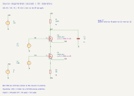
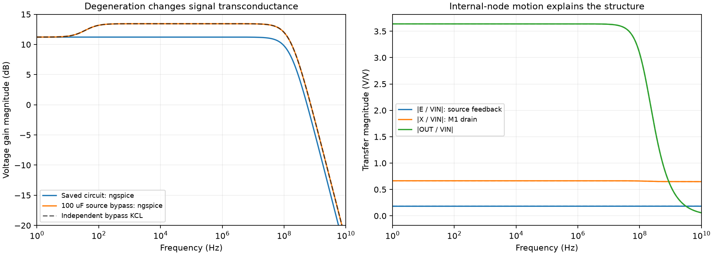
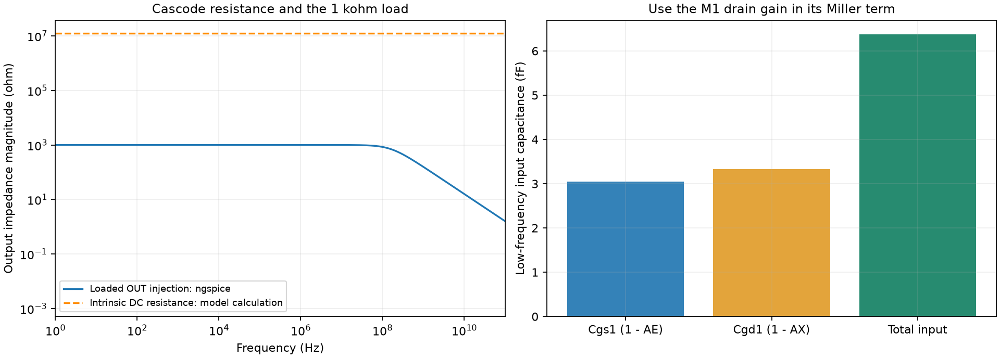
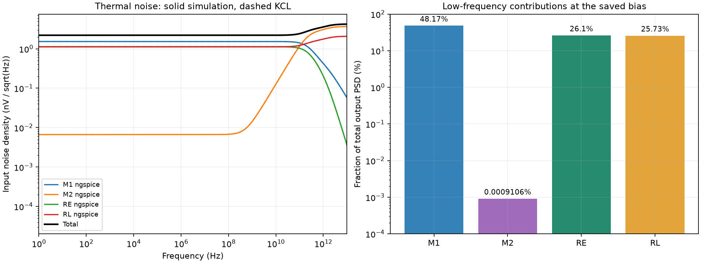
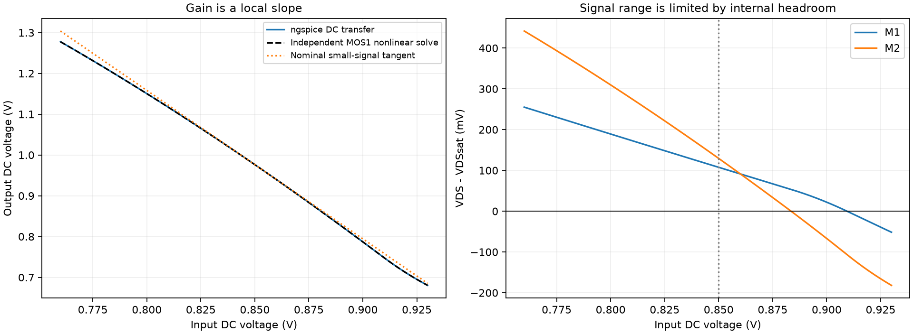
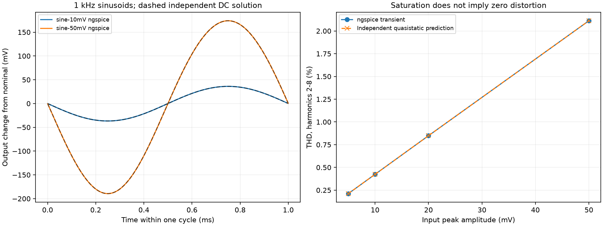
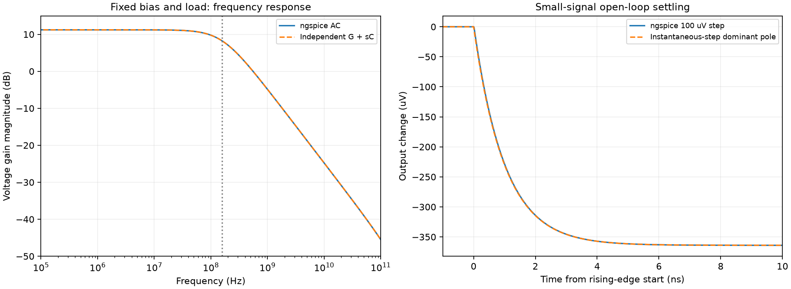

<!--
Input: saved KiCad schematic, existing LEVEL=1 model and structure-specific testbenches | Output: derivations, measured plots and independent checks at the adjusted bias | Position: Companion to Source-Degenerated-Cascode-Analysis.md
-->
# Source-Degenerated Cascode Amplifier: Schematic and Simulation

This study follows the **current saved KiCad circuit** and asks four structural questions: how RE creates feedback, what M2 contributes as a cascode, how each noise source reaches the output, and where small-signal amplification stops describing a finite input. Each section connects a mechanism and derivation to a specific experiment, measured curves and numerical checks. RL and RE remain fixed throughout the main study.

**Verification status:** 16 testbenches ran on 2026-10-11 with KiCad 10.0.6's bundled **ngspice-46**. The baseline has both MOSFETs conducting in saturation. Complex KCL, per-source thermal noise, nonlinear DC equations, poles/zeros, sinusoidal distortion and small-step settling were independently checked. Predictions that use simulated gm/gmb/gds/capacitances are independent circuit calculations, not independently calibrated device parameters. The model is **educational LEVEL=1, not a SKY130 PDK or a prediction of 150-nm silicon**.

The original m=1, RL=50 ohm / 10 kohm experiments, flicker illustration, supply tests and resistor scans are retained in [the historical companion](Source-Degenerated-Cascode-Historical-Baseline.md). They describe a different bias and geometry and are not numerical evidence for the current circuit.

## Current Circuit and Reproducible Assets



The drawing is exported from the saved schematic; only page whitespace is cropped. [PNG preview](figures/source-degenerated-cascode/current/cascode-dc.png) is also available. Both bulk terminals connect to VSS. VIN, VB, VDD, CL and OUT are referenced to external ground; VSS is held at 0 V.

| Element | Connections or condition | Current value |
|---|---|---|
| M1 | D=X, G=VIN, S=E, B=VSS | W=1 um, L=150 nm, **m=10** |
| M2 | D=OUT, G=VB, S=X, B=VSS | W=1 um, L=150 nm, **m=10** |
| R1 / RL | VDD to OUT | **1 kohm** |
| R2 / RE | E to VSS | **50 ohm** |
| C1 / CL | OUT to external ground | 1 pF |
| V1 / VDD | Supply | 1.8 V |
| V2 / VIN | Input DC bias | **0.85 V** |
| V3 / VB | M2 gate bias | **1.40 V** |
| V4 / VSS | Body and source-return rail | 0 V |

Multiplicity m=10 represents ten parallel devices of the stated per-device W/L. In this model, queried gm, gmb, gds and capacitances already include multiplicity; they must not be multiplied by ten again.

| Asset | Role |
|---|---|
| [Saved KiCad schematic](circuits/source-degenerated-cascode/kicad/cascode-dc.kicad_sch) and [GUI guide](circuits/source-degenerated-cascode/kicad/README.md) | Shared editable source; the runner does not edit it |
| [Model snapshot](simulations/source-degenerated-cascode/models.lib) | Existing NMOS_EDU model, unchanged |
| [Structure-study runner](code/run_cascode_structure.py) | Exports the saved schematic, runs experiments and performs independent checks |
| [Executed decks, methods and raw data](simulations/source-degenerated-cascode/current-study/README.md) | Separate directory for this study |
| [Execution report](simulations/source-degenerated-cascode/current-study/summary.json) | Actual tool identity, parameters, hashes, measured metrics and checks |
| [Original Canvas source and provenance](circuits/source-degenerated-cascode/provenance.json) | Preserved historical source; the Canvas teaching copy has not been updated to this KiCad bias |

The model has VTO=0.45 V, KP=200 uA/V², LAMBDA=0.03 V⁻¹, GAMMA=0.4 V½, PHI=0.7 V, TOX=20 nm and CGSO=CGDO=200 pF/m. Temperature is 27 °C. KF=0 in this study; junction capacitances and source/drain series resistance are absent. All bias and supply sources are ideal and noiseless. No additional external low-impedance load is connected.

## 1. Establish the Bias and Voltage Budget

The current path is VDD → RL → M2 → M1 → RE → VSS. M1 controls the branch current; RE develops a source voltage; M2's gate bias sets the internal-node voltage X. At VSS=0,

$$
V_E=I_DR_E,\qquad V_O=V_{DD}-I_DR_L,\qquad I_{D1}=I_{D2}.
$$

For grounded bodies, the threshold and saturated current equations are

$$
V_{Ti}=0.45+0.4\left(\sqrt{0.7+V_{Si}}-\sqrt{0.7}\right),
$$

$$
I_{Di}=m_i\frac{200\,\mathrm{\mu A/V^2}}{2}\frac{W_i}{L_i}
(V_{GSi}-V_{Ti})^2(1+0.03V_{DSi}).
$$

Use the conducting-saturation margin $V_{DS}-V_{DSsat}$, rather than output voltage alone, to assess headroom. Raising VB raises X and redistributes voltage from M2 to M1; it does not provide a second cascaded voltage-gain factor.

**Testbench:** [OP](simulations/source-degenerated-cascode/current-study/op.cir) exports the actual saved values and queries each device. An independent nonlinear implementation solves branch current and X using the declared device equations; its solution also predicts the DC transfer in Section 5.

| Quantity | Measured OP |
|---|---:|
| Branch current / supply power | 0.823664 mA / 1.48260 mW |
| OUT / X / E | 0.976336 V / 0.497874 V / 0.0411832 V |
| M1 gm / gmb / gds | 4.71861 mS / 1.09618 mS / 24.3760 uS |
| M2 gm / gmb / gds | 4.72013 mS / 0.862539 mS / 24.3603 uS |
| M1 VDS / VDSsat / margin | 0.456691 V / 0.349113 V / **+107.578 mV** |
| M2 VDS / VDSsat / margin | 0.478462 V / 0.349000 V / **+129.462 mV** |

Both devices conduct in saturation with reasonably balanced nominal margins. Section 5 tests how those margins change during the signal; this OP check alone does not establish a low-distortion input range.

## 2. Source Degeneration: Feedback, Gain and Linearity

An increase in VIN initially raises M1 current. RE converts that increase into a rise of E, reducing the increase in VGS and supplying local negative feedback. Grounded bulk terminals also make the rising source voltage increase threshold; gmb therefore belongs in the feedback denominator.

Let $k_i=g_{mi}+g_{mbi}+g_{di}$. With rails and VB grounded in AC, the unknowns are ordered **E, X, OUT**. The MOS current convention is $i_d=g_mv_g+g_{mb}v_{body}+g_dv_d-kv_s$, giving

$$
G\begin{bmatrix}v_E\\v_X\\v_o\end{bmatrix}
=\begin{bmatrix}g_{m1}\\-g_{m1}\\0\end{bmatrix}v_i,
\qquad
G=\begin{bmatrix}
1/R_E+k_1&-g_{d1}&0\\
-k_1&g_{d1}+k_2&-g_{d2}\\
0&-k_2&1/R_L+g_{d2}
\end{bmatrix}.
$$

The same result follows by tracking the incremental series current:

$$
i=g_{m1}v_i+g_{d1}v_X-k_1v_E,\quad v_E=iR_E,
\quad i=av_i+bv_X,
$$

$$
a=\frac{g_{m1}}{1+k_1R_E},\quad b=\frac{g_{d1}}{1+k_1R_E},\quad
\Delta=k_2+b(1+g_{d2}R_L).
$$

M2 gives $i=g_{d2}v_o-k_2v_X$, while $v_o=-iR_L$. Thus

$$
\boxed{A_v=-\frac{R_Lak_2}{\Delta}},\qquad
A_E=\frac{R_Eak_2}{\Delta},\qquad
A_X=-\frac{a(1+g_{d2}R_L)}{\Delta}.
$$

Neglecting small drain-conductance corrections gives

$$
\boxed{G_m\approx\frac{g_{m1}}{1+(g_{m1}+g_{mb1})R_E}},\qquad A_v\approx-G_mR_L.
$$

At this OP the approximate feedback denominator is **1.29074**: effective transconductance is approximately **77.5%** of the bare gm. In the strong-degeneration limit, gain tends toward a resistor-ratio limit with an additional body-effect factor; increasing current does not provide unlimited gain.

**Testbenches:** [input AC](simulations/source-degenerated-cascode/current-study/ac-input.cir) uses VIN AC=1, a derivative normalization. [Source bypass AC](simulations/source-degenerated-cascode/current-study/ac-bypass.cir) adds a noiseless 100 uF capacitor across RE. The capacitor is open at DC; a [separate OP test](simulations/source-degenerated-cascode/current-study/bypass-op.cir) verifies unchanged bias. At 10 kHz its reactance is about 0.159 ohm, so it nearly removes source feedback in AC. This capacitor is a diagnostic addition, not a component added to the saved schematic.



Solid node curves are simulated; dashed curves are the independent KCL solution. The bypass transition occurs near $1/(2\pi R_EC_B)$, approximately 32 Hz; the complete circuit modifies that simple corner estimate.

| Observable | Independent prediction | Simulation |
|---|---:|---:|
| Low-frequency Av | −3.63974839 V/V | −3.63974838 V/V |
| Approximate Av | −3.65574308 V/V | Approximation overestimates magnitude by 0.439% |
| E/VIN / X/VIN | +0.181987 / −0.664953 | Full complex AC agrees with KCL |
| Bypassed Av at 10 kHz | KCL including the bypass capacitor | −4.69767 − j0.004050 V/V |

The approximately 22.5% reduction in gain magnitude directly exposes source feedback at unchanged DC bias. Removing RE physically would also change current and device parameters, mixing two mechanisms.

### A control experiment for distortion

For a large-signal feedback comparison, an [ideal DC source-clamp control](simulations/source-degenerated-cascode/current-study/sine-clamped-10mV.cir) replaces RE with a voltage source equal to the nominal E voltage. Its [OP check](simulations/source-degenerated-cascode/current-study/clamp-op.cir) verifies the same initial bias, but E cannot move with the signal. This is an ideal diagnostic circuit.

With the same 1 kHz, 10 mV-peak input, the saved circuit produces **36.3963 mV** output fundamental and **0.42434% THD**; the source-clamped control produces **46.9768 mV** and **0.70642% THD**. RE reduces distortion at this input amplitude while reducing gain. Output amplitudes differ, so this experiment is not an equal-output-amplitude linearity comparison. THD includes harmonics 2–8; its measurement and independent prediction are specified in Section 5.

## 3. Cascode Action: Output Resistance and Internal-Node Motion

If OUT moves, M2 changes its VGS to oppose changes in branch current. M1's drain therefore moves less than OUT, while the branch's incremental output resistance becomes much larger than either device's ro. Source degeneration also raises the resistance presented to M2.

Apply a test voltage at M1's drain with input and body grounded in AC:

$$
R_1=r_{o1}+\left[1+(g_{m1}+g_{mb1})r_{o1}\right]R_E.
$$

The common-gate stage gives

$$
\boxed{R_{stack}=r_{o2}+\left[1+(g_{m2}+g_{mb2})r_{o2}\right]R_1},
\qquad R_{out}=R_L\parallel R_{stack}.
$$

The output-short-circuit transconductance is $G_m=ak_2/(k_2+b)$, so $A_v=-G_mR_{out}$. A large intrinsic resistance produces little loaded-gain benefit once RL dominates.

**Testbench:** [output AC injection](simulations/source-degenerated-cascode/current-study/ac-output.cir) drives 1 A AC into OUT with the gate sources grounded in AC. The unit current normalizes impedance and is not a physical 1 A signal. Intrinsic resistance is independently calculated by removing RL's conductance from the linearized KCL matrix; this is a model calculation, not a separately simulated unloaded nonlinear bias.



| Quantity | Independent model calculation | Simulation |
|---|---:|---:|
| M1 ro / resistance R1 including RE | 41.02 kohm / 53.0013 kohm | From queried OP parameters |
| Intrinsic cascode Rstack | **12.2404 Mohm** | Closed form agrees with unloaded KCL |
| Loaded Rout | **999.918 ohm** | **999.918 ohm**, 1 Hz injection |
| Output-short-circuit Gm | 3.64005 mS | Av and Rout are consistent with −Gm Rout |

The cascode raises the model's branch resistance by roughly 231 times relative to R1, yet the actual output resistance is essentially 1 kohm. These quantities must be distinguished when explaining the moderate voltage gain.

### The input Miller term uses X, not OUT

The M1 gate current follows the voltages across its own capacitors:

$$
Y_{in}(s)=s\left[C_{gs1}(1-A_E(s))+C_{gd1}(1-A_X(s))+C_{gb1}\right].
$$

Here Cgs1=3.72657 fF, Cgd1=2.00000 fF and Cgb1=0, already including m=10. Low-frequency AE=+0.181987 and AX=−0.664953 give a Cgs contribution of about 3.04838 fF and a Cgd contribution of 3.32991 fF, totaling **6.37829 fF**. The Miller factor on Cgd is **1.66495**, because M1's drain is X. Substituting the output gain −3.63975 into that term would describe the wrong capacitor connection.

The input-AC deck measures VIN source current, and its admittance agrees with the independent capacitor-current expression over the frequency grid. Tiny teaching-model capacitances and missing junction/wiring capacitances limit the physical interpretation.

## 4. Thermal Noise: Source Generation Versus Source Transfer

M2 has almost the same gm as M1, and therefore generates almost the same intrinsic channel-current noise in this model. Its output contribution can nevertheless be tiny: a disturbance generated by M2 primarily moves X, while M1's high drain resistance constrains the branch current. The relevant quantity is generated PSD multiplied by its circuit transfer, not gm alone.

Use one-sided PSDs at 300.15 K. Saturated MOS1 channel sources have $S_{i,Mj}=4k_BT(2/3)g_{mj}$; resistor Norton sources have $S_{i,R}=4k_BT/R$. In E/X/OUT order, independent source injections are

$$
q_{M1}=\begin{bmatrix}1\\-1\\0\end{bmatrix},\quad
q_{M2}=\begin{bmatrix}0\\1\\-1\end{bmatrix},\quad
q_{RE}=\begin{bmatrix}1\\0\\0\end{bmatrix},\quad
q_{RL}=\begin{bmatrix}0\\0\\1\end{bmatrix}.
$$

For source j, $h_{j,o}(s)=[(G+sC)^{-1}q_j]_3$ and $S_{v,o,j}=|h_{j,o}|^2S_{i,j}$. Independent source **powers** add. Referred to VIN at low frequency,

$$
\left|\frac{h_{M1,o}}{A_v}\right|=\frac1{g_{m1}},\qquad
\left|\frac{h_{M2,o}}{A_v}\right|=\frac{g_{d1}}{g_{m1}k_2},
$$

$$
\left|\frac{h_{RE,o}}{A_v}\right|=\frac{k_1R_E}{g_{m1}},\qquad
\left|\frac{h_{RL,o}}{A_v}\right|=\frac1{G_m}.
$$

Therefore

$$
\boxed{S_{v,in}^{th}=4k_BT\left[
\frac{2/3}{g_{m1}}+
R_E\left(\frac{k_1}{g_{m1}}\right)^2+
\frac23g_{m2}\left(\frac{g_{d1}}{g_{m1}k_2}\right)^2+
\frac{1}{G_m^2R_L}\right]}.
$$

For the two channel sources specifically,

$$
\boxed{\frac{S_{v,in,M2}}{S_{v,in,M1}}=
\frac{g_{m2}}{g_{m1}}\left(\frac{g_{d1}}{k_2}\right)^2
\approx1.89059\times10^{-5}}.
$$

As gd1 tends to zero, this model's low-frequency M2 contribution tends to zero. At higher frequencies, capacitive currents at E and X change that constraint, so the low-frequency suppression must not be extended to all frequencies.

**Testbench:** [thermal noise](simulations/source-degenerated-cascode/current-study/noise.cir) retains KF=0, references input source V2, and captures total and individual M1/M2/RE/RL spectra. Each source is separately predicted using its independent current-injection KCL transfer. Source-power addition and $e_{n,in}=e_{n,out}/|A_v|$ are checked across the same 1 Hz–100 THz mathematical frequency grid as AC.



Solid spectra are simulated; dashed spectra are independent KCL predictions. The full grid exposes model behavior and is not a process frequency-validity claim.

| Source, 1 Hz | Input-referred density | Fraction of total output PSD |
|---|---:|---:|
| M1 | 1.53034 nV/sqrt(Hz) | **48.1663%** |
| M2 | 0.00665406 nV/sqrt(Hz) | **0.000910627%** |
| RE | 1.12658 nV/sqrt(Hz) | **26.1031%** |
| RL | 1.11849 nV/sqrt(Hz) | **25.7297%** |
| Total | **2.20504 nV/sqrt(Hz)** | 100% |

Total output density is **8.02579 nV/sqrt(Hz)**. The noise transfer predictions agree with every simulated source spectrum within 0.03% relative tolerance; low-frequency M2/M1 power ratio agrees with the closed form.

Three structural conclusions follow. M1 is the largest contributor. RE's feedback reduces gain and improves the tested linearity, but RE also adds substantial thermal noise. M2's own low-frequency channel noise is strongly suppressed, rather than absent. M1's input-referred channel-noise transfer is exactly 1/gm1 in this low-frequency model, so gain reduction alone does not establish an improvement in input-referred noise.

For a finite band, $v_{n,in,rms}=\sqrt{\int_{f_1}^{f_2}S_{v,in}(f)df}$. Integrating **10 Hz–100 kHz**, including interpolated endpoints, gives **0.697260 uV RMS**. Amplitude densities are combined through squares; they are not summed directly.

### M2 gate-bias noise is a separate path

The [VB AC deck](simulations/source-degenerated-cascode/current-study/ac-bias.cir) checks

$$
A_b=-\frac{R_Lb g_{m2}}{\Delta}=-0.0158285\ \mathrm{V/V}
$$

at low frequency. Noise generated by a real VB source would refer to VIN through $|A_b/A_v|$; it is not the same as M2 channel noise. No bias-generator noise is included in the totals above. Similarly, ideal supply sources omit supply noise; RL provides a strong positive-rail-to-output path. KF=0 also means these are thermal-only totals. The historical 1/f illustration belongs to the archived m=1 cases and is not reused as a current-case numerical result.

## 5. Signal Range: Local Gain, Distortion and Saturation

The small-signal gain is the slope at VIN=0.85 V. A finite sinusoid samples neighboring slopes and changes the internal voltage budget. The independent nonlinear solver uses the same body-effect threshold and saturated equation above, switching to

$$
I_D=m K_P\frac WL\left[(V_{GS}-V_T)V_{DS}-\frac12V_{DS}^2\right](1+\lambda V_{DS})
$$

in the forward triode region. It solves current and X from the two transistor equations, with E=ID RE and OUT=VDD−ID RL. This is an independent device-equation implementation, rather than an interpolation of simulated DC data.

**Testbench:** [DC transfer](simulations/source-degenerated-cascode/current-study/dc-transfer.cir) varies VIN from **0.76 to 0.93 V in 0.5 mV steps**, holding VB, RL, RE and dimensions fixed. It records OUT/E/X and both saturation margins. A central derivative using VIN=0.8495 and 0.8505 V is compared with nominal AC gain.



| Check | Independent prediction | Simulation |
|---|---:|---:|
| Nominal slope | AC/KCL: −3.63974839 V/V | Central DC slope: −3.63974799 V/V |
| OUT/E/X across the DC interval | Independent MOS1 nonlinear solution | Agreement within 1e−7 relative plus 2 nV absolute tolerance |
| Upper sampled VIN with both devices saturated | Saturation margins from the actual solution | **0.8835 V**; next sampled point violates M2 saturation |

The lower endpoint 0.76 V still has both devices saturated and is only the beginning of this tested interval, not a measured lower boundary. At VIN=0.90 V, M2's margin is about −66.9 mV. Thus a symmetric 50 mV-peak sinusoid around 0.85 V crosses the saturation boundary even though its fundamental gain can remain close to the nominal value.

### Predict distortion before measuring it

For a smooth static transfer f near the bias,

$$
f(V_{IN}+A\sin\omega t)\approx f(V_{IN})+
f'A\sin\omega t+\frac12f''A^2\sin^2\omega t,
\qquad \frac{H_2}{H_1}\approx\frac{|f''|A}{4|f'|}.
$$

The DC curvature and slope predict approximately **0.42431% second harmonic at A=10 mV**. This curvature-based estimate uses measured DC derivatives; the separate full-waveform prediction below uses independently solved device equations. Since 1 kHz is far below the output pole, the nonlinear DC solution should closely predict the transient waveform and its harmonics.

**Testbenches:** [5 mV](simulations/source-degenerated-cascode/current-study/sine-5mV.cir), [10 mV](simulations/source-degenerated-cascode/current-study/sine-10mV.cir), [20 mV](simulations/source-degenerated-cascode/current-study/sine-20mV.cir) and [50 mV](simulations/source-degenerated-cascode/current-study/sine-50mV.cir) apply 1 kHz sinusoids around 0.85 V. Transient duration is 10 ms, maximum timestep 1 us; a least-squares fit of DC plus sine/cosine harmonics 1–8 over the last 4 ms measures amplitudes and THD. Identical harmonic extraction is applied to independently predicted quasistatic waveforms evaluated at the measured input samples.



| Input peak | Output fundamental peak | Simulated THD, H2–H8 | Independent quasistatic THD | Minimum M1 / M2 margin |
|---|---:|---:|---:|---:|
| 5 mV | 18.1986 mV | 0.212169% | 0.212160% | +99.5 / +110.6 mV |
| 10 mV | 36.3963 mV | 0.424341% | 0.424342% | +91.4 / +91.5 mV |
| 20 mV | 72.7855 mV | 0.848859% | 0.848860% | +75.2 / +53.0 mV |
| 50 mV | 181.811 mV | 2.11216% | 2.11216% | +22.1 / **−66.9 mV** |

The harmonic predictions agree within 0.2% relative tolerance, and fundamental amplitudes within 0.02%. Both devices remaining saturated does not guarantee negligible distortion: a 20 mV input remains saturated but has about 0.85% THD. Conversely, a nearly unchanged fundamental gain does not establish that the devices remain saturated. An acceptable amplitude requires a distortion specification as well as a voltage-margin check.

## 6. Frequency Response and Small-Step Settling

With the stated model's zero junction capacitances and ideal gate sources, the dynamic unknowns remain E/X/OUT:

$$
C=\operatorname{diag}(C_{gs1},C_{gd1}+C_{gs2},C_L+C_{gd2}),
$$

$$
(G+sC)\mathbf v=
\left[\begin{bmatrix}g_{m1}\\-g_{m1}\\0\end{bmatrix}
+s\begin{bmatrix}C_{gs1}\\C_{gd1}\\0\end{bmatrix}\right]v_i.
$$

Let $a_E=1/R_E+k_1$, $a_X=g_{d1}+k_2$, $a_O=1/R_L+g_{d2}$. The transfer denominator and numerator are

$$
D(s)=(a_E+sC_E)\left[(a_X+sC_X)(a_O+sC_O)-g_{d2}k_2\right]
-g_{d1}k_1(a_O+sC_O),
$$

$$
N(s)=k_2\left[-g_{m1}/R_E+
s\{a_EC_{gd1}+(k_1-g_{m1})C_{gs1}\}
+s^2C_{gs1}C_{gd1}\right].
$$

The poles are eigenvalues of $-C^{-1}G$ and zeros are roots of N. Opposite constant/quadratic signs give one LHP and one RHP zero in this model. The 1 pF output load should dominate the low-frequency pole, predicting $f_p\approx1/[2\pi R_{out}(C_L+C_{gd2})]$.

**Testbenches:** input AC is compared with the full complex matrix over 1 Hz–100 THz, 80 points/decade. The [PZ deck](simulations/source-degenerated-cascode/current-study/poles-zeros.cir) uses a controlled input source and 1 Gohm DC return at its signal port, so an ideal voltage source does not short the PZ excitation. Signed roots reconstruct the entire AC transfer.



| Feature | Simulated result, independently checked |
|---|---:|
| Low-frequency gain | −3.63975 V/V, 11.2214 dB |
| Slow LHP pole | **158.846 MHz** |
| Measured falling −3.000 dB crossing | **158.469 MHz** |
| First falling unity-gain crossing | **555.901 MHz** |
| Other LHP poles | 156.336 GHz and 1.10372 THz |
| RHP / LHP zeros | +226.064 GHz / −1.41878 THz |

The −3.000 dB crossing differs slightly from an ideal pole's −3.0103 dB point. With gain only 3.64, the single-pole unity approximation $f_u\approx f_p\sqrt{|A_v(0)|^2-1}$ is more appropriate than simply multiplying pole frequency by DC gain. GHz/THz roots reflect the incomplete, tiny teaching capacitances; they are not a fabrication-speed claim.

For a dominant pole, $\Delta v_o(t)\approx A_v(0)\Delta v_i(1-e^{-t/\tau})$ and $t_\epsilon\approx\tau\ln(1/\epsilon)$. The [small-step deck](simulations/source-degenerated-cascode/current-study/step.cir) applies VIN=0.85→0.8501 V with a 20 ps rising edge. A last-exit criterion measures settling relative to the plateau, from the end of the rising edge and before the falling edge.

| Step metric | Dominant-pole / AC prediction | Simulation |
|---|---:|---:|
| Final output change | −363.975 uV | −364.006 uV |
| 1% settling | 4.61412 ns | 4.60583 ns |
| 0.1% settling | 6.92118 ns | 6.91280 ns |

The plateau agrees with AC within 0.04%, and settling agrees with the dominant-pole prediction within 3%. Finite input-edge duration and internal dynamics explain the small residual. This is a small-signal open-loop experiment.

## Reproduce and Interpret the Study

From the repository root:

```powershell
python code/run_cascode_structure.py
```

The runner derives every deck from the **saved** `.kicad_sch`, checks terminal tuples and conducting saturation, runs in a temporary directory, and publishes results after the checks pass. Unsaved GUI edits are not visible. It requires the existing per-user KiCad installation plus NumPy, SciPy and Matplotlib; simulator subprocess windows are hidden. The [lab guide](simulations/source-degenerated-cascode/current-study/README.md) describes files and measurement definitions. Six plot pairs are generated as PNG/SVG, together with a fresh KiCad SVG export. The optional PNG schematic preview is rasterized from that SVG.

The report records the saved schematic, model, runner, ngspice DLL and executed-deck hashes. A later rerun follows later saved edits, so its numerical report should be checked before using the numbers printed in this note. Historical results remain in their own directory.

The current circuit is a useful small-signal teaching amplifier: source feedback trades gain for tested linearity and adds resistor noise; M2 raises intrinsic resistance and suppresses its low-frequency channel-noise contribution; RL limits loaded gain; internal headroom and distortion limit useful signal amplitude. A process design additionally needs an appropriate PDK, real parasitics, realistic bias/supply noise and specified loading, temperature, mismatch and distortion targets.

## Appendix: Historical Resistor Experiments

The [historical companion](Source-Degenerated-Cascode-Historical-Baseline.md) retains the complete original study and its [26-deck report](simulations/source-degenerated-cascode/results/summary.json), including the original source provenance, supply/bias transfer derivations and illustrative flicker model. Those experiments used **m=1, VIN=0.75 V and VB=1.25 V**, not the current values.

| Historical condition | Current | Av | Interpretation |
|---|---:|---:|---|
| RL=50 ohm, RE=50 ohm | 59.2716 uA | −0.0194479 | Original low-impedance load limits gain |
| RL=10 kohm, RE=50 ohm | 59.2680 uA | −3.88900 | Same geometry/bias, larger load |
| Historical load scan, RL=20 kohm | Recomputed OP | −7.70008 | First sampled load with M2 outside saturation |
| Historical RE scan, RE=5 kohm, RL=10 kohm | 20.4583 uA | −0.962156 | Bias and feedback both change |

The old load and RE scans remain available for design tradeoff exploration. They are not the main evidence used to explain source feedback or M2 noise in the current circuit.

## Sources and Derivation Ownership

1. User-edited [native KiCad schematic](circuits/source-degenerated-cascode/kicad/cascode-dc.kicad_sch), read at the hash recorded in the current report; original Canvas [provenance](circuits/source-degenerated-cascode/provenance.json) remains separate.
2. The unchanged [NMOS_EDU model](simulations/source-degenerated-cascode/models.lib) and [ngspice documentation](https://ngspice.sourceforge.io/docs.html), with actual execution by ngspice-46.
3. [MOS1 channel-noise implementation](https://github.com/ngspice/ngspice/blob/master/src/spicelib/devices/mos1/mos1noi.c), for the saturated channel-noise convention; current per-source simulation independently verifies its use with m=10.
4. [KiCad simulation documentation](https://docs.kicad.org/10.0/en/eeschema/eeschema.html#simulator), for native schematic/model bindings and GUI workflow.

KCL, resistance and noise-transfer expressions, the transfer polynomial, and the independent nonlinear and harmonic calculations are this study's derivations. The archived note supplies historical context, not current-case verification.
